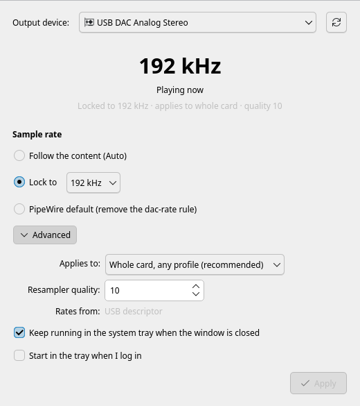
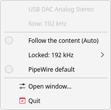
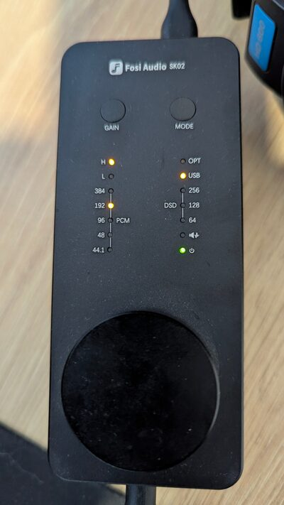

# dac-rate

Pick the sample rate of a USB DAC (or any ALSA output) on Linux with PipeWire, and keep it after reboots and replugs.

By default PipeWire runs most outputs at 48 kHz and resamples everything to that. `dac-rate` lets you either:

- **lock** a device to one rate (for example 192 kHz), so everything is resampled to that rate once, in PipeWire, or
- set it to **Auto**, so the device switches to each file's own rate (44.1 kHz music plays at 44.1 kHz, 96 kHz plays at 96 kHz).

It runs as your user, needs no root, and only touches the device you pick. Use it from an app window, from a tray icon, or from the command line.

## The app

<p align="center">
  
  &nbsp;
  
</p>

Open **DAC Sample Rate** from your app menu:

- **Live rate:** the big number is the rate your DAC is running at right now, read from the hardware once a second.
- **Choose:** *Follow the content (Auto)*, *Lock to* a rate, or *PipeWire default*, then **Apply**. Sound pauses for about a second while the audio service restarts.
- **Advanced:** which outputs the rule covers (whole card, one USB port, or one output) and the resampler quality.
- **Warnings:** other config files that also set rates for your DAC are listed in a yellow box, with which one wins.
- **Tray icon:** shows the live rate as a badge. Its menu switches between Auto, a locked rate and the default without opening the window. Closing the window keeps it in the tray; **Start in the tray when I log in** makes it permanent.

The app uses the `dac-rate` command for every change, so the app, the tray and the command line always agree.

## Dependencies

Most of these come with any desktop that uses PipeWire. Usually you only need to install `jq`, and check that your WirePlumber is 0.5 or newer. `./install.sh --check` checks all of this without installing anything. It lists what's missing and prints the install command for your distro (Arch, Debian/Ubuntu or Fedora family).

### Required

| What | Used for | Arch | Debian / Ubuntu | Fedora |
|---|---|---|---|---|
| bash 4+ | the script itself | `bash` | `bash` | `bash` |
| `pw-dump`, `pw-cat`, `pw-metadata` | find devices, show the hardware rate, warn about a forced rate | `pipewire` | `pipewire-bin` | `pipewire-utils` |
| **WirePlumber 0.5+** | reads the rules dac-rate writes | `wireplumber` | `wireplumber` | `wireplumber` |
| `jq` | reads PipeWire's device list | `jq` | `jq` | `jq` |
| systemd user session | restarts the audio services to apply a change (without it, log out and back in) | built in | built in | built in |

Plus the standard tools every Linux desktop has: `sed`, `awk`, `grep`, `sort`, `xargs`, `timeout`.

### Optional

| What | Without it | Arch | Debian / Ubuntu | Fedora |
|---|---|---|---|---|
| Python 3 + **PySide6** | the app window and tray icon; without it the launcher opens a simple picker instead | `pyside6` | `python3-pyside6.qtcore` `python3-pyside6.qtgui` `python3-pyside6.qtwidgets` `python3-pyside6.qtnetwork` | `python3-pyside6` |
| `kdialog` or `zenity` | (only without PySide6) the simple picker works in the terminal only | `kdialog` / `zenity` | `kdialog` / `zenity` | `kdialog` / `zenity` |
| `aplay` | non-USB cards get a standard 44.1–192 kHz list instead of their real rates | `alsa-utils` | `alsa-utils` | `alsa-utils` |
| `notify-send` | no desktop notification after choosing from the launcher | `libnotify` | `libnotify-bin` | `libnotify` |
| `update-desktop-database` | the launcher may take a moment to show up in the app menu | `desktop-file-utils` | `desktop-file-utils` | `desktop-file-utils` |

### Install them

```bash
# Arch
sudo pacman -S --needed pipewire wireplumber jq alsa-utils libnotify pyside6
# Debian 13 / Ubuntu 25.10+
sudo apt install pipewire-bin wireplumber jq alsa-utils libnotify-bin \
  python3-pyside6.qtcore python3-pyside6.qtgui python3-pyside6.qtwidgets python3-pyside6.qtnetwork
# Fedora
sudo dnf install pipewire-utils wireplumber jq alsa-utils libnotify python3-pyside6
```

Leave out the PySide6 packages if you only want the command line.

### WirePlumber 0.5: which distros have it

Check yours with `wireplumber --version`. dac-rate refuses to run on 0.4, which uses a different config format.

| Distro | WirePlumber | Works? |
|---|---|---|
| Arch, EndeavourOS | 0.5.18 | yes |
| Fedora 43, 44, 45 | 0.5.14–0.5.18 | yes |
| Debian 13 (trixie) | 0.5.8 | yes |
| Debian 12 (bookworm) | 0.4.13 | only with `bookworm-backports` (0.5.8) |
| Ubuntu 25.10, 26.04 LTS | 0.5.10, 0.5.13 | yes |
| Ubuntu 24.04 LTS | 0.4.17 | no |
| Ubuntu 22.04 LTS | 0.4.8 | no (and PipeWire isn't the default there) |

Versions were checked on the distros' package sites in October 2026.

Tested on Arch Linux, KDE Plasma 6 (Wayland), PipeWire 1.6, WirePlumber 0.5.18, with a Fosi Audio SK02 USB DAC. The lock holds after a reboot, after turning the DAC off and on, and after switching the card's profile.

<p align="center">
  
  <br>
  <em>Fosi Audio SK02 after <code>dac-rate set 192000</code>: the DAC's own PCM light shows 192.</em>
</p>

## Install

```bash
git clone https://github.com/vcostin/dac-rate.git && cd dac-rate
./install.sh
```

It checks the dependencies first. If something required is missing, it stops and prints the install command. Otherwise it copies `dac-rate` and `dac-rate-gui` to `~/.local/bin` and adds a **DAC Sample Rate** launcher to your app menu. The launcher opens the app when PySide6 is installed, or a simple picker otherwise. If you install PySide6 later, run `./install.sh` again.

## Command line

```bash
dac-rate devices              # list outputs; * marks the remembered one
dac-rate use "SK02"           # remember a device (node name or part of its name)
dac-rate rates                # rates the device supports, and where that list came from
dac-rate set 192000           # lock to 192 kHz
dac-rate set auto             # follow the content
dac-rate reset                # remove the rule, back to PipeWire defaults
dac-rate status               # rule, hardware rate, and any other config that affects the device
```

Run `dac-rate` with no arguments for a simple picker in the terminal. `--json` prints devices, rates and status as JSON, which is what the app reads.

Changing the rate restarts WirePlumber, so sound pauses for about a second. Turning Auto on or off restarts PipeWire as well, and a few apps may need restarting to get sound back.

### Options

| Option | What it does |
|---|---|
| `-d DEVICE` | Act on another device without changing the remembered one. |
| `-m card` | *(default)* The rule covers every output of this card, in any profile (Analog, Digital, Pro Audio). |
| `-m port` | The rule covers this card only when plugged into **this USB port**. Use this for two identical DACs. |
| `-m node` | The rule covers this exact output only, for example one HDMI output of a graphics card. |
| `-q N` | Resampler quality 0–14 (PipeWire's default is 4; 10 is high quality and uses more CPU). `-q default` removes it. |
| `-n` | Write the rule without restarting anything; it prints the command to apply it. |

`-m` and `-q` are remembered in the rule, so a later `dac-rate set 96000` keeps them.

Each card has one rule. With `-m node`, the rule covers one output of that card; setting a second output of the same card is refused until you reset the first or switch to `-m card`.

To choose the picker yourself, set `DAC_RATE_GUI=kdialog`, `zenity` or `0` (terminal). If a change fails from the launcher, the error appears in a dialog.

## Check that it works

Play something, then:

```bash
grep -E '^rate|closed' /proc/asound/card*/pcm*p/sub0/hw_params
```

or run `pw-top` and look at your device's line. The FORMAT column shows the rate the device runs at, such as `S32LE 2 192000`.

When nothing is playing, the device shows `closed`. That's normal: PipeWire releases it after a few seconds of silence.

## Lock or Auto, and bit-perfect playback

**Lock** converts everything to one rate. 44.1 kHz music on a 192 kHz lock is resampled once, by PipeWire, with the quality set by `-q`. It's simple and predictable, and your DAC's display always shows the same rate. It is not bit-perfect.

**Auto** lets the device follow the content, but only while **one** source is playing. PipeWire runs one clock per device, so if a second sound at a different rate starts (a browser tab, a notification), it's converted to the rate of whatever started first.

For bit-perfect playback, all of these must hold:

- `dac-rate set auto` on the device
- only the music player is playing
- the player's volume and the system volume are at 100% (use the DAC's own volume knob instead)
- the player doesn't convert the audio itself (check its output or resampling settings)

Browsers and many games produce 48 kHz audio themselves, so Auto changes nothing for them.

## How it works

`dac-rate set` writes one WirePlumber rule per card:

```
~/.config/wireplumber/wireplumber.conf.d/60-dac-rate-<card>.conf
```

The rule sets `audio.allowed-rates` on the card's playback outputs: one rate for a lock, or every rate the card supports for Auto. WirePlumber applies it whenever the device appears (at login, after a replug, when you turn the DAC on, or after a profile change), so the rate survives reboots without a startup script.

Auto also needs the rates in PipeWire's global list, otherwise PipeWire never leaves 48 kHz. For that it writes:

```
~/.config/pipewire/pipewire.conf.d/60-dac-rate.conf   (default.clock.allowed-rates)
```

That file merges in any `default.clock.allowed-rates` you set yourself, always keeps 44.1 and 48 kHz, and is removed when no device is in Auto mode. While it exists, other outputs can switch rates too.

**Supported rates** come from, in order:

1. the USB descriptor (`/proc/asound/cardN/stream0`) on USB devices,
2. the driver itself via `aplay --dump-hw-params`, which only works while the device is idle,
3. a standard 44.1–192 kHz list, which `dac-rate rates` labels as a guess.

**Conflicts:** `dac-rate status` lists other WirePlumber files that set rates for the same card, and says whether they win or lose against dac-rate (files load in name order). It also warns about a runtime `clock.force-rate`, which some scripts set and which forces every device.

## Limitations

- **WirePlumber 0.4** (Lua config) is not supported.
- **ALSA outputs only.** Bluetooth headphones get their rate from the codec (SBC, AAC, LDAC), not from PipeWire, so this tool can't change it.
- **A rate change always interrupts sound.** The DAC has to be reopened to switch rates, so there's a short gap even without a restart.
- **No exclusive mode.** PipeWire has nothing like Windows' WASAPI exclusive mode. Players that need it must open the ALSA device directly (mpd and some others can), outside PipeWire.
- **No native DSD.** This tool handles PCM rates only.
- **Rate lists are only as good as the driver.** If a driver reports a rate it can't play, `dac-rate` will offer it.
- **Conflict detection is a best effort.** It finds files that mention the card's name; a rule with a broader pattern (for example `~alsa_output.usb-.*`) isn't detected.

## Troubleshooting

- **The rate doesn't change:** run `dac-rate status` while something plays and read any warnings it lists. If the rule is right but the rate isn't, restart the audio stack (`systemctl --user restart pipewire pipewire-pulse wireplumber`).
- **An app plays to the wrong output:** some players are set to a specific device in their own settings and ignore the system default. Check the player's audio-device option.
- **A rate isn't offered:** check where the list came from with `dac-rate rates`. If it says "standard list", stop playback and run it again so the driver can be asked.
- **Two identical DACs swap settings:** use `-m port` on each.

## Uninstall

```bash
dac-rate reset        # for each device you set up
./install.sh --uninstall   # also removes the app's login item
```

## License

MIT, see [LICENSE](LICENSE).
